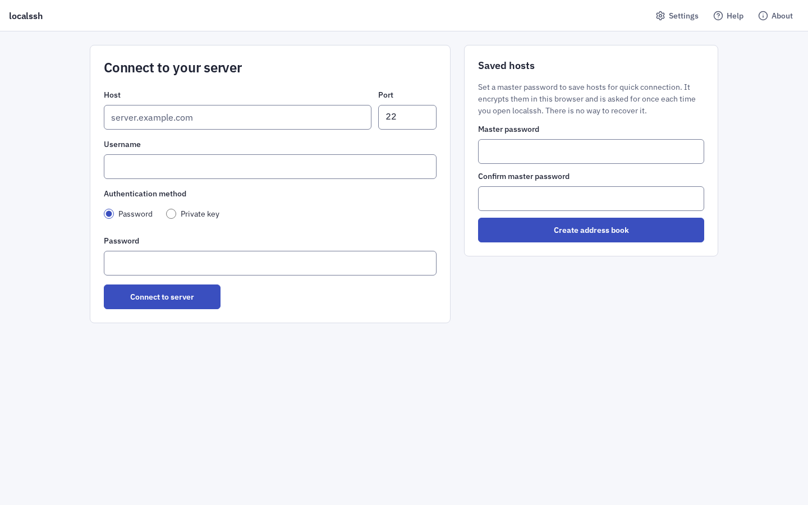
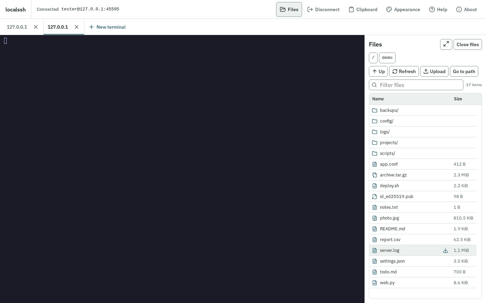

# localssh

An SSH client that runs in the browser. The SSH implementation is compiled to
WebAssembly and runs in the page, so the handshake, authentication,
and host-key verification all happen on your device. The relay in between moves
encrypted bytes and cannot read the session.

The relay exists because browsers cannot open raw TCP sockets. It is a dumb
pipe: it never sees your password, and a malicious relay cannot impersonate a
server without failing the host-key check performed in the browser.

If you find this useful, please consider starring the repository. It helps
others discover the project.

## Features

- **Browser-native SSH.** The Go SSH engine runs as WebAssembly in the tab.
  Password or private-key authentication, host-key verification, and terminal I/O stay between
  the browser and the SSH server.
- **Encrypted saved hosts.** The optional [address book](#address-book) saves a
  nickname, host, port, username, and optionally a password. The entire address
  book is encrypted under a master password before it enters browser storage.
- **Known-host verification.** First connections show the server's SHA-256
  fingerprint. Accepted keys are remembered in the browser, and a changed key
  produces a separate security warning before any connection continues.
- **Configurable terminal.** The [terminal](#terminal) supports selectable font
  size, system or bundled monospace fonts, persistent colour schemes,
  scrollback, automatic PTY resizing, and full-screen sessions.
- **Multiple live terminals.** Open another server without closing current
  shells. Each tab has its own SSH session, output, and terminal size.
- **SFTP files.** Browse remote directories in a compact 360px side panel with
  breadcrumbs, sortable file details, a name filter, and keyboard navigation.
  In large folders only the list scrolls, and only the rows in view
  are drawn. Upload by choosing or dropping a file,
  watch transfer progress, and download from each connected tab. Replacing an
  existing file requires confirmation. On desktop, expand Files to use the
  full session area while the terminal stays connected.
- **Task notifications.** Short messages confirm transfers, clipboard actions,
  address book changes, and session endings. Hover or focus a message to keep
  it visible while you read it.
- **In-app help.** Searchable help covers connection, host keys, files, touch
  controls, privacy, and recovery without leaving the app.
- **Phone and tablet controls.** The responsive interface includes a
  [touch key bar](#key-bar), sticky Ctrl and Alt modifiers, terminal gestures, a
  [clipboard menu](#clipboard), keyboard-aware viewport fitting, and 44px touch
  targets.
- **Self-hosted LAN deployment.** Docker Compose serves the frontend and relay
  through one port. Origin, target host, target port, concurrent session, and
  connection-time limits constrain relay access and resource use.
- **No application account or credential server.** Typed passwords are not
  persisted. Saved credentials remain encrypted in that browser profile, and
  the relay carries only the end-to-end encrypted SSH stream.

## Interface preview





See the [user guide](docs/USER-GUIDE.md) for the current controls.

## Repository layout

| Path       | What it is                                                       |
| ---------- | ---------------------------------------------------------------- |
| `engine/`  | Go SSH engine compiled to WebAssembly, plus a test SSH server     |
| `relay/`   | Node WebSocket-to-TCP relay                                      |
| `frontend/`| React and Vite UI with the xterm.js terminal                      |

## Install with Docker

Install Docker Engine or Docker Desktop. The combined image serves the
page and `/relay` on one port. This command binds only to the Docker host's
loopback address:

```bash
docker run -d --name localssh -p 127.0.0.1:9080:80 ghcr.io/bradsec/localssh:latest
```

Open <http://localhost:9080>. The combined image checks that relay requests
come from the page's origin by default. Set `ALLOWED_HOSTS` and
`ALLOWED_PORTS` when exposing it to other devices. This image command has not
been run here because a Docker image could not be built in this environment.

For the same image with Compose, from a repository checkout run:

```bash
docker compose -f compose.all-in-one.yaml up -d
```

The [two-image Compose file](compose.yaml) remains available. It pulls the
frontend and relay images and proxies `/relay` through the frontend port:

```bash
git clone https://github.com/bradsec/localssh.git
cd localssh
docker compose up -d
```

Open <http://localhost:9080>.

The Compose commands above passed `docker compose config --quiet` here. The
containers themselves have not been run here.

### Update the two-image Compose installation

Pull the new images and recreate the containers. Compose replaces only what
changed, and a session is only interrupted for as long as the containers take to
restart:

```bash
cd localssh
git pull
docker compose pull
docker compose up -d
```

Review changes to `compose.yaml`, the proxy configuration, and `.env.example`
before updating your own `.env`.

This tracks the `latest` tag. To move deliberately between releases, set the
version in `.env` and recreate. Published versions are listed on the
[releases page](https://github.com/bradsec/localssh/releases):

```dotenv
LOCALSSH_VERSION=YYYY.MM.DD
```

Old images stay on disk after an update. Remove the ones no longer referenced
with `docker image prune`.

For `compose.all-in-one.yaml`, pull and recreate with the same `-f` option.
For `docker run`, pull the image, then recreate the named container with the
same port, policy, and TLS settings. Recreating a container disconnects its
active SSH sessions. Those image operations were not executed here.

### Stop or remove the Docker installation

Stop and remove the application containers and network:

```bash
docker compose down
```

To also remove the downloaded frontend and relay images:

```bash
docker compose down --rmi all --remove-orphans
```

These two commands apply to `compose.yaml`. They do not remove the source
checkout or `.env` configuration. Use `docker compose -f
compose.all-in-one.yaml down` for the combined Compose option, or
`docker rm -f localssh` for the named `docker run` container. Removal commands
were not executed here.

Both Compose examples bind to `127.0.0.1` by default. The frontend proxies relay
traffic internally through the same web port in the two-image setup.

### Access from a local network

Install localssh on one server, and other devices can use it through a browser.
Each visitor's browser runs its own SSH engine and stores its own known hosts.
Use trusted HTTPS for LAN access: plain LAN HTTP can be changed by an on-path
actor before the browser runs the SSH engine. It is also not a secure context,
so browsers restrict the Clipboard API. `http://localhost` is treated
differently by browsers. See [Secure contexts](https://developer.mozilla.org/en-US/docs/Web/Security/Defenses/Secure_Contexts)
and [Clipboard API](https://developer.mozilla.org/en-US/docs/Web/API/Clipboard_API)
(accessed 2026-11-01, current browser platform guidance).

Give the server a stable LAN address or hostname, then copy and edit the
configuration:

```bash
cp .env.example .env
```

For a server at `192.168.1.20`, use:

```dotenv
BIND_ADDRESS=0.0.0.0
FRONTEND_PORT=9080
ALLOWED_ORIGINS=*
ALLOWED_HOSTS=server.example.com,*.internal.example
ALLOWED_PORTS=22
```

Hostname allowlist entries trust DNS for those names. An attacker controlling
that DNS can point an allowed name at any internal address. Prefer target IPs
or names under DNS you control, and restrict the host's outbound traffic to the
intended SSH targets.

Start the application and open <http://192.168.1.20:9080> from another
computer:

```bash
docker compose up -d
```

Allow inbound TCP port `9080` from the trusted LAN in the server firewall.

`ALLOWED_ORIGINS=*` is the recommendation for a firewalled local network because
visitors arrive by whatever address they typed: the LAN IP, a short hostname, an
mDNS `.local` name. An exact-match list has to name every one of them, and an
address that changes with a DHCP lease breaks the deployment. What the wildcard
costs: any page open in a visitor's browser can also reach the relay and dial the
hosts you allowlisted. `ALLOWED_HOSTS` is therefore the boundary that matters,
so keep it to the hosts you intend, not `*`.

To keep an exact-match list instead, name every URL people use, including the
ones used on the server itself:

```dotenv
ALLOWED_ORIGINS=http://192.168.1.20:9080,http://server.local:9080,http://localhost:9080
```

Do not expose this HTTP service directly to the internet. Any browser that can
reach it can use the unauthenticated relay to connect to `ALLOWED_HOSTS`, and
plain HTTP does not protect the page from modification in transit. Use a
restrictive target allowlist and put an internet-facing deployment behind an
authenticated HTTPS reverse proxy.

### HTTPS for the combined image

The combined server uses HTTPS and WSS on the same port when both
`TLS_CERT_FILE` and `TLS_KEY_FILE` point to readable files inside the container.
Mount a certificate and private key, then set both variables. Use a certificate
trusted by every client device. [mkcert](https://github.com/FiloSottile/mkcert)
can issue certificates from a local CA for private use; install that CA on each
client and never distribute its private key (project README, accessed
2026-11-01). A trusted reverse proxy such as Caddy is another option. Keep
the proxy and the service on a protected network, and allow WebSocket upgrades
on `/relay`. The certificate and proxy paths are environment-dependent and
were not executed here.

### When a browser cannot connect

A browser is not told why a WebSocket handshake failed: the relay's 403 and its
reason are hidden from the page, which can only report that the relay could not
be reached. The relay logs refused origins and targets, so check there first:

```bash
docker compose logs relay
```

A refused origin means the address that visitor used is not in
`ALLOWED_ORIGINS`; a refused target means the host or port they asked for is not
in `ALLOWED_HOSTS` or `ALLOWED_PORTS`.

### Configuration

Copy the example before changing the bind address, port, or target allowlist:

```bash
cp .env.example .env
```

| Variable | Default | Meaning |
| -------- | ------- | ------- |
| `LOCALSSH_VERSION` | `latest` | Image tag for both images in two-image Compose. |
| `BIND_ADDRESS` | `127.0.0.1` | Host interface for the web port. Use `0.0.0.0` for LAN access. |
| `FRONTEND_PORT` | `9080` | Host port for the web interface. |
| `ALLOWED_ORIGINS` | local frontend URLs in two-image Compose; `*` with same-origin Host checks in the combined image | Browser origins allowed to use the relay. Explicit entries match exact scheme, host, and port; `*` permits any origin in the standalone relay. |
| `PUBLIC_HOSTS` | unset | Combined image only. Comma-separated public page hostnames allowed in default same-origin mode; case-insensitive, without ports. |
| `ALLOWED_HOSTS` | `*` | Comma-separated target hosts. `*.example.com` matches subdomains, not the bare name. A hostname rule trusts DNS for that name. |
| `ALLOWED_PORTS` | `22` | Comma-separated target TCP ports. |
| `MAX_SESSIONS` | `256` | Maximum active plus detached relay sessions. At capacity, the relay evicts the oldest detached session; it refuses a new connection if all are attached. Budget about 896 KiB of RAM per attached session. |
| `KEEPALIVE_MAX_SECONDS` | `3600` (`0` when `ALLOWED_ORIGINS=*` is explicitly set) | Maximum detached-session lifetime in seconds. `0` permits v1 only. `unlimited` holds orphaned sessions until capacity eviction, relay restart, or server-side close. Set an explicit value to enable resume with wildcard origins. |
| `TARGET_CONNECT_TIMEOUT_MS` | `10000` | Maximum time in milliseconds for the relay to establish a target TCP connection. |
| `PORT` | `80` combined, `8787` standalone relay | Container listener port; change the Docker port mapping with it. |
| `HOST` | `0.0.0.0` | Listener interface inside the container. |
| `TLS_CERT_FILE`, `TLS_KEY_FILE` | unset | Combined image only. Both paths must be set for HTTPS and WSS. |
| `STATIC_ROOT` | `/app/frontend` | Combined image static-file directory; intended for local tests or development. |

`LOCALSSH_VERSION` selects the image tag in [two-image Compose](compose.yaml).
The [combined Compose example](compose.all-in-one.yaml) and `docker run` command
use `latest` as written; edit their image reference to pin a published
`YYYY.MM.DD` or `YYYY.MM.DD.N` tag. Compose reads `.env` for interpolation;
the example does not pass every variable to the combined container. See
[Docker's Compose interpolation reference](https://docs.docker.com/compose/how-tos/environment-variables/variable-interpolation)
(accessed 2026-11-01, current Compose CLI).

In the combined image, the default same-origin check accepts IP addresses,
`localhost`, single-label names, and names ending in `.local`, `.lan`,
`.home.arpa`, or `.internal`. Set `PUBLIC_HOSTS=app.example.com` when you serve
the page under your own domain; matching Origin and Host headers alone cannot
protect the relay from DNS rebinding. An explicit `ALLOWED_ORIGINS` list keeps
its existing behavior and does not use `PUBLIC_HOSTS`.

The combined image's unset `ALLOWED_ORIGINS` uses same-origin Host checks and
the 3600-second keep-alive default. Explicit `ALLOWED_ORIGINS=*` disables resume
unless `KEEPALIVE_MAX_SECONDS` is set. The relay reports support and its cap at
`GET /capabilities` in the combined image, or `GET /relay/capabilities` through
the two-image nginx proxy. A direct standalone relay also answers
`GET /capabilities`. Cross-origin pages can read this response only when their
Origin is in `ALLOWED_ORIGINS`; the supplied frontend CSP permits `ws:` and
`wss:` but only same-origin HTTP requests. Supported deployments use the page
and relay on the same origin.

For resumable sessions, the relay may take up to 90 seconds to detect an
inactive page before it starts the keep-alive period. Output can stall while
the page is away because the relay pauses TCP reads when its buffer fills.
The SSH server's `ClientAliveInterval` can end a held connection sooner.
Keep each session on one relay instance: a relay restart loses its sessions.
Use `tmux` on the SSH host for commands that must keep running if the page or
relay disappears. `unlimited` can leave closed-tab sessions holding sockets
until capacity eviction, restart, or server-side close. Size `MAX_SESSIONS`
for available RAM; 256 attached sessions at about 896 KiB each use up to
about 224 MiB for session state.

Unless it is `*`, `ALLOWED_ORIGINS` must contain every exact URL used to open the
interface, including its scheme, hostname or address, and non-default port. For a
private set of SSH targets, replace `*` with explicit names:

```dotenv
ALLOWED_HOSTS=server.example.com,*.internal.example
```

### Changing ports

Edit `.env` and keep the allowed origin synchronized with the published web
port. For example, to use port `9180` locally:

```dotenv
FRONTEND_PORT=9180
ALLOWED_ORIGINS=http://localhost:9180,http://127.0.0.1:9180
```

Recreate the containers after changing these values:

```bash
docker compose up -d
```

Then open <http://localhost:9180>. If Docker reports that the port is already
allocated, choose an unused `FRONTEND_PORT` and update `ALLOWED_ORIGINS`.

## Versioning

localssh uses calendar versions in `YYYY.MM.DD` format. Same-day patch releases
append a revision number as `YYYY.MM.DD.N`.

`VERSION` holds the release, and nothing else in the repository repeats it:
releasing is a one-line edit to that file. The frontend build reads it, the
release workflow validates it and passes it to all three image builds as the
`VERSION` build argument, which becomes the image tag and the OCI metadata. The
npm packages are private and never published, so they carry a fixed `0.0.0`
rather than a copy of the release, and a container built by hand with no build
argument labels itself `development`.

The About panel shows the running version, so anyone can read it without
inspecting the containers.

Changing `VERSION` on `main` runs the Release workflow. It validates
the calendar date, runs the engine, relay, frontend, and browser checks, publishes
multi-platform frontend, relay, and combined images to GitHub Container Registry, and
creates a matching `vYYYY.MM.DD` or `vYYYY.MM.DD.N` GitHub release. Each
calendar version can be released only once. All versioned images must finish
building and attestation before any `latest` tag is promoted. Registry tag
updates are separate operations, so promotion is not atomic across images.
Pin `LOCALSSH_VERSION` for the two-image Compose pair, or pin the combined
image tag in its command or Compose file.

The [Quality workflow](.github/workflows/quality.yml) runs on pull requests
and pushes to `main`. It checks Go, relay, frontend, Chromium browser tests,
and a combined-image Docker smoke test. The [Release workflow](.github/workflows/release.yml)
runs on a `VERSION` change pushed to `main` or by manual dispatch. Live GitHub
workflow execution has not been verified here.

## Security model

What this design does and does not protect you from:

- **The relay cannot read your session.** SSH is negotiated end to end between
  the browser and the target, so the relay only ever sees ciphertext.
- **Host keys are verified in the browser.** On first connection you are shown
  the SHA-256 fingerprint and must accept it. Accepted keys are stored in
  IndexedDB, and a later change is reported as a warning you must confirm.
- **Typed passwords stay in memory.** A password you type lives in React state
  for the life of the connection and is never written to storage or sent to any
  origin server.
- **Private keys stay on your device.** Select or paste an OpenSSH Ed25519,
  ECDSA, or RSA key, an unencrypted PKCS#8 PEM key, or a legacy RSA or EC PEM key.
  OpenSSH and legacy PEM keys may use a passphrase; encrypted PKCS#8 PEM is
  unsupported. The key and passphrase are used for this connection only, never
  saved in the address book or sent to the relay. A host-key prompt can reuse
  the key after you trust the server; cancelling that prompt discards it.
- **Saved passwords are encrypted on your device.** The optional address book
  seals every saved host under a master password, using Argon2id and
  XChaCha20-Poly1305 inside the WebAssembly engine. A saved password is never
  written in plain text, never leaves the browser, and is never handed to the
  page: the engine holds it and uses it directly when you connect.
- **Anyone who can reach your relay can dial the hosts you allowlisted.** The
  relay does not authenticate users. Keep `ALLOWED_HOSTS` tight, and put the
  relay behind access control if it faces the internet.
- **This has not been independently audited.** Treat it accordingly.

## Address book

Saving hosts is optional and off until you set a master password. Without one,
localssh stores no credentials at all.

Each saved host carries a nickname and, at your choice, the host alone, the
host and username, or the host, username, and password. Picking an entry that
holds everything connects in one tap; anything less fills the form and waits
for the rest.

Saved entries can be edited or deleted from their options menu. The vault can
be locked without reloading the page, and its master password can be changed
after entering the current password. If the password is lost, deleting the
whole vault requires typing an explicit confirmation phrase.

### How it is protected

The master password is stretched with Argon2id and the address book is sealed
with XChaCha20-Poly1305. Both run in the WebAssembly engine rather than through
the browser's WebCrypto, because `crypto.subtle` is unavailable over plain
HTTP, which is how a LAN deployment is normally reached. The derived key never
leaves the engine, and neither does a saved password: connecting passes a
reference to the entry, and the engine supplies the password itself.

The vault is a single encrypted blob in `localStorage`. Nicknames, hostnames,
and usernames are inside it, so a reader of your browser storage learns only
that a vault exists.

Vault writes use IndexedDB to serialize changes across tabs while keeping the
existing encrypted blob in `localStorage`. A stale save locks the vault and
asks you to reload and unlock again; unsaved edits must be entered again.
Reset also refuses to delete a vault changed by another tab.
Reload all open tabs after upgrading from a version without this protection.

An unlock lasts one page load. Reloading, opening a new tab, or restarting the
browser asks for the master password again.

Setting the master password asks for it twice, because there is no recovery
from a typo. A strength meter sits under the field. It is guidance only: it
never blocks a password, and it applies no character-class rules. This draws
on the usability guidance in NIST SP 800-63B-4, where length is a primary
factor and mandatory symbol rules are prohibited. It is not a claim of NIST
compliance: this is a local encryption feature, and its small common-password
list gives feedback rather than acting as a verifier blocklist. The meter rates
the password alone. A weak master password makes a weak vault whatever the
encryption behind it is.

### What it does not protect you from

- **There is no recovery.** Forgetting the master password means the saved
  hosts are gone. The only way forward is to delete the vault and start again.
- **A saved password is only as strong as the master password over it.** The
  Argon2id parameters make guessing expensive, not impossible.
- **Anyone with the device and the master password has the credentials.**
- **A shared server means a shared browser profile.** If several people use the
  same browser on the same machine to reach localssh, they share one vault. On
  the LAN deployment this README recommends, each visitor uses their own browser
  on their own device, and their vaults stay separate. Do not create a vault in
  a browser other people use.
- **This has not been independently audited.** Treat it accordingly.

## Terminal

Font, font size, line height, and colour scheme are configurable from **Settings**.
All-host settings persist in `localStorage`. Line height defaults to 1.15 and
ranges from 1.00 to 2.00 in 0.05 steps. Changes apply to open terminals. For a
saved host, unlock the vault and choose **This host** under **Apply to** to store
its terminal settings in the encrypted vault. Removing that override restores
the all-host settings. System Monospace is the default; Fira Code,
JetBrains Mono, Cascadia Code, IBM Plex Mono, and Source Code Pro are available
as optional bundled fonts. Font size is a picker, which a phone renders as a
scroll wheel. The terminal reports its fitted size to the remote PTY, so
resizing the window, rotating a phone, or opening an on-screen keyboard keeps
width-aware commands formatting correctly.

Select **New terminal** to connect to another server. On a phone, select the
target to open **Open terminals** and switch shells; on desktop, select a tab.
Close disconnects only that shell. On a hardware
keyboard, Ctrl+Alt+Shift+Left and Ctrl+Alt+Shift+Right switch tabs. Closing the
page disconnects all sessions in v1/Off mode. If the relay reaches `MAX_SESSIONS`, close a
terminal and try again; the browser cannot distinguish this from other failed
WebSocket handshakes. SSH keepalives
detect silent network loss and show a connection error after missed replies.
In **Settings**, choose **Off**, **2 min** (default), **5 min**, **10 min**,
**15 min**, **1 hour**, or **Until I disconnect** for terminals opened next.
The relay may cap the time; Settings shows the effective limit. While the
session is held, anyone using this browser can access its terminal without
signing in. Choose a shorter time on a shared device.

With keep-alive enabled and a relay that supports resume, leaving the page
detaches the transport. On return, **Resuming** keeps the terminal output in
view until the same SSH session returns. If it has ended, a recovery row shows
the cause and offers **Reconnect** and **Close terminal**. **Select text**
remains available for closed-session output. Reconnect uses credentials in one
tap only when they are in the unlocked vault. Otherwise, the connect form opens
with host, port, and user filled. New output follows a marker identifying the
new connection. Reloading starts a new page and requires a new login. Use
`tmux` or `screen` on the server for work that must survive a closed session.
If a new connection needs a host-key check, **Return to open terminal** keeps
the other shells available; select the connecting tab to resume the check.

Select **Files** in a connected tab (under **Actions** below 1024px wide) to
browse that server. Breadcrumbs open earlier folders; **Go to path** opens the
**Remote path** field. Double-click a folder, including a link to a folder,
or select **Up** for its parent. Columns sort by name, size, modified time,
or permissions. Type in **Filter files** to narrow the folder by name,
ignoring case; the count beside it reads, for example, `12 of 2,000 items`, and
clearing it restores the list and selection. The folder path, toolbar, filter,
and column headings stay in place while the list scrolls inside the panel.
Rows are 32px with a mouse or trackpad and 44px on touch screens. Arrow keys,
Home, End, Page Up, and Page Down move the selection; Enter opens a folder and
Backspace or Alt+Up opens the parent. Choose **Upload** or drop a file onto Files. If the name already
exists on the server, localssh asks before
replacing it; the replacement keeps the old file's permissions but not its
owner or access lists, and a link at that name is replaced, not followed.
Uploads stage to a hidden `.localssh-upload-*` file. A failed replacement on a
server without `posix-rename@openssh.com` can remove the old file; the error
names the staged copy to recover. Closing Files or disconnecting waits
up to 10 seconds for that file to be removed; a stage file left behind by a
lost connection is removed the next time its folder is listed after 24 hours.
Select the download action beside a file to save it through the browser.
Transfers keep up to 16 requests of 32 KiB in flight; the browser uses file
storage when available, with a 16 MiB memory fallback when it is not. On
iPhone or iPad, a download pauses while the page is in the background and
continues when the session resumes. Keep localssh open until it finishes. If
the session expires, sign in to the same host and choose **Resume download**
to continue from saved bytes. If the remote file changed or partial data is
missing, choose **Retry** to start over. If iOS closes the page, it may remove
partial download data; reload, sign in, and retry when resume is unavailable.
Use the browser's download, Share, or Save to Files action when
prompted. If automatic saving is blocked, select **Save download** in the file
panel; the browser copy stays for 10 minutes or until the next transfer, Close
files, or leaving the page. **Close files** leaves the terminal connected and
asks first if a transfer is running; disconnecting the tab stops its transfer.
Control and text-direction characters in remote names display as `<U+XXXX>`.

The toolbar's Help button opens a searchable guide to connection setup,
host-key checks, saved hosts, terminal controls, files, keyboard shortcuts, copy and
paste, connection problems, privacy, and self-hosting. It works on the connect
screen and during a session, ships with the app, and closes with Escape. Failed
connections, the host-key prompts, the saved-hosts unlock and reset forms, and
the clipboard fallback link to the matching topic. A failed or dropped
connection names the likely cause and next step; its Technical details line
keeps the engine's original message.

## Phones and tablets

The interface is built for a small touch screen as much as for a desktop
browser. On a phone the terminal runs to the edges of the screen, and controls
stay at or above the 44px touch target. Below 1024px wide, a session toolbar
shows the connection status and target beside one **Actions** button, which
holds Files, Disconnect, Clipboard, Settings, Help, and About. In short phone
landscape with the keyboard open, the target and key bar share a row at the top
to leave more room for terminal output. Pinch does not change terminal text
size; use Settings or the Text smaller and Text larger keys.

Connection details come before the optional saved-host vault. The connect page
scrolls when its contents exceed the viewport, including while the keyboard is
open.

While a session is up, the shell follows the visual viewport rather than the
page, so the terminal refits into whatever the on-screen keyboard leaves and the
cursor row stays above it. Tapping the terminal raises the keyboard, and
dismissing it is left to the keyboard's own control.

### Key bar

A touch device gets a key bar along the bottom of the session, carrying the keys
a phone keyboard has none of. It stays above the on-screen keyboard when that
is open and on its own when it is not. A closed session shows recovery controls
in its place. The key bar includes:

| Keys                       | Notes                                              |
| -------------------------- | -------------------------------------------------- |
| Keyboard icon              | Raises and dismisses the on-screen keyboard, for reading output on a full screen and typing again without hunting for the terminal. |
| `ctrl`, `alt`              | Sticky. One tap arms them for the next key, a second locks them until tapped off. |
| `↑`, `↓`, `⏎`              | Recall a command and run it without opening the keyboard at all. |
| `esc`, `tab`, `⇧tab`       | Escape, Tab, and Shift Tab.                        |
| `^C`, `^D`, `^Z`           | Interrupt, end of input, suspend.                  |
| `←`, `→`, `home`, `end`    | Sent in whichever encoding the terminal is in, so they work inside `vim` and `less`. |
| `\|`, `/`, `~`, `-`        | Punctuation buried behind a shift on a phone.      |
| `A-`, `A+`               | Text smaller and Text larger, within 8 to 32 px.   |

With `ctrl` armed, a letter typed on the system keyboard arrives as its control
code, so `ctrl` then `r` is a reverse history search. The row shows as many keys
as fit between Keyboard (always first) and More keys (always last), so it never
scrolls sideways. The rest are in the More keys panel, which takes the
on-screen keyboard's place, holds up to four rows (40 percent of the screen at
most, scrolling inside), and stays open while you tap keys. Keyboard, More keys,
Escape, switching terminals, Files or Settings close it. Tapping a key in the
row never takes focus from the terminal, so the keyboard does not close
underneath it.

In **Settings**, **Edit key bar** lets you move, remove, add, or reset keys.
Keyboard and More keys stay fixed. The order is saved on this device.

### Touch gestures

On a phone, drag vertically with one finger to scroll terminal output. A
horizontal drag or prompt flick sends no shell key; use the visible key bar.
Touch and hold terminal text to select it with the native handles and Copy
callout; touch and hold empty space for the native Paste callout. **Select
text** in the Actions menu opens a read-only view with native text selection
for scrollback beyond the screen. It also works after a session closes. Desktop and tablet terminal
gestures remain unchanged.

### Clipboard

On touch screens, touch and hold terminal text to select it with the native
handles and use the device's Copy action; touch and hold empty space for the
native Paste callout, which works over plain HTTP. For scrollback beyond the
screen, **Select text** in the Actions menu opens a read-only view with native
selection handles. A **Clipboard** menu sits in the session toolbar (under **Actions**
below 1024px wide) for copying a live terminal selection and pasting without a
hardware keyboard:

| Control                | Action                                                     |
| ---------------------- | ---------------------------------------------------------- |
| Copy selection         | Copies the current terminal selection. Enabled only while text is selected. |
| Paste here             | A field to paste into with the on-screen callout; its contents are sent to the session. |
| Paste from clipboard   | Reads the system clipboard directly and sends it. Best effort: the browser blocks clipboard reads on the plain-HTTP LAN deployment, and the paste field is the fallback. |

If automatic copy fails, the menu shows the selected text in a read-only field.
Select it and use the device's Copy action.

A dot on the menu marks when the terminal has a selection ready to copy, and
turns green once that selection has been copied.

The selection stays in place when the on-screen keyboard opens or closes, which
happens on the way to the Clipboard menu. Typing into the session clears it.

## Development

Development from source uses Go 1.27.3 and Node.js 26. The npm manifests
require Node 26. Run `source ~/.nvm/nvm.sh && nvm use 26` if using nvm, then
install dependencies with `npm ci` in both `relay/` and `frontend/`. Build the
engine before starting the frontend. These commands run from the repository root:

```bash
source ~/.nvm/nvm.sh && nvm use 26
cd engine
go test ./...
GOOS=js GOARCH=wasm go vet ./...
./build.sh
cd ../relay
npm ci
npm test
npm run lint
npm run format:check
npm run build
cd ../frontend
npm ci
npm test
npm run lint
npm run format:check
npx tsc -b
npm run build
npm run test:e2e
```

The browser suite builds the engine and starts a local test SSH server and
relay. For interactive development, run `npm run relay:local` in `relay/`
and `VITE_RELAY_WS_URL=ws://127.0.0.1:8787 npm run dev` in `frontend/`
after `./build.sh`. See the component READMEs
for their interfaces. The full command sequence was not rerun solely for this
documentation edit; individual checks are recorded in the audit report.

## Credits and acknowledgements

### Libraries

| Project | Used for | Licence |
| ------- | -------- | ------- |
| [xterm.js](https://github.com/xtermjs/xterm.js) (`@xterm/xterm`, `@xterm/addon-fit`) | Terminal emulator and sizing | MIT |
| [golang.org/x/crypto](https://pkg.go.dev/golang.org/x/crypto/ssh) | Go SSH client implementation | BSD-3-Clause |
| [Go](https://go.dev) and its `syscall/js` WebAssembly support | The engine and its browser bridge | BSD-3-Clause |
| [React](https://react.dev) | UI | MIT |
| [Vite](https://vite.dev) | Build tooling and dev server | MIT |
| [TypeScript](https://www.typescriptlang.org) | Type checking | Apache-2.0 |
| [Vitest](https://vitest.dev) | Unit tests | MIT |
| [Playwright](https://playwright.dev) | Browser end-to-end tests | Apache-2.0 |
| [Testing Library](https://testing-library.com) | Component test helpers | MIT |
| [oxlint](https://oxc.rs) | Linting | MIT |
| [idb](https://github.com/jakearchibald/idb) | IndexedDB wrapper for known hosts | ISC |
| [ws](https://github.com/websockets/ws) | WebSocket server for the local dev relay | MIT |

### Fonts

All bundled through [Fontsource](https://fontsource.org).

| Font | Designer | Licence |
| ---- | -------- | ------- |
| [Fira Code](https://github.com/tonsky/FiraCode) | Nikita Prokopov, from Fira Mono by Erik Spiekermann and Carrois Apostrophe | SIL OFL 1.1 |
| [JetBrains Mono](https://www.jetbrains.com/lp/mono/) | JetBrains | SIL OFL 1.1 |
| [Cascadia Code](https://github.com/microsoft/cascadia-code) | Microsoft | SIL OFL 1.1 |
| [IBM Plex Mono and IBM Plex Sans](https://github.com/IBM/plex) | Mike Abbink and Bold Monday for IBM | SIL OFL 1.1 |
| [Source Code Pro](https://github.com/adobe-fonts/source-code-pro) | Paul D. Hunt for Adobe | SIL OFL 1.1 |

### Colour schemes

Terminal palettes reproduce the published colours of their upstream projects:
[Solarized](https://ethanschoonover.com/solarized/) (Ethan Schoonover, MIT),
[Dracula](https://draculatheme.com) (Zeno Rocha, MIT),
[Nord](https://www.nordtheme.com) (Arctic Ice Studio, MIT),
[Gruvbox](https://github.com/morhetz/gruvbox) (Pavel Pertsev, MIT),
[One Dark](https://github.com/atom/atom) (Atom, MIT),
[Monokai](https://monokai.pro) (Wimer Hazenberg),
[Catppuccin](https://github.com/catppuccin/catppuccin) (MIT), and
[Tokyo Night](https://github.com/enkia/tokyo-night-vscode-theme) (MIT).

### Interface icons

Interface icons use [Lucide](https://lucide.dev) (ISC licence), bundled from the
`lucide-react` npm package at build time. The page makes no request for icons at
runtime.

The GitHub mark in the About panel is a trademark of GitHub, Inc., used to link
to the project's repository.

## Licence

[MIT](LICENSE)
